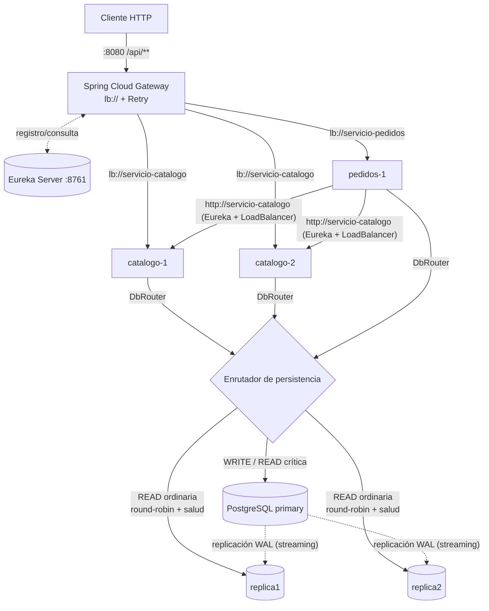

# Microservicios con descubrimiento dinámico, balanceo de carga y persistencia replicada

Sistema de **tienda en línea** con dos microservicios de negocio (`servicio-catalogo` y `servicio-pedidos`) sobre
**Spring Boot 3.5 + Spring Cloud 2025.0**, con **Eureka** (descubrimiento), **Spring Cloud Gateway** (entrada y balanceo)
y **PostgreSQL 17 replicado** (1 primario + 2 réplicas) con enrutamiento propio de lecturas y escrituras.

**Equipo**

| Integrante | Parte | Responsabilidad |
|---|---|---|
| Peter Orrala Villón | A | Infraestructura, PostgreSQL replicado y Eureka |
| Ismael Anchundia Catuto | B | Persistencia (db-routing) y servicio-catalogo |
| Amy Tomala Silvestre | C | servicio-pedidos y Spring Cloud Gateway |
| Skay Alvarado Rodriguez | D | Pruebas P01–P08, evidencias y documentación |

**Video demostrativo:** https://drive.google.com/file/d/1Rjw9jjB1EH0xAPIB8GUkbYEat8X5I-Do/view?usp=sharing <!-- completar: enlace público -->

## 1. Arquitectura



| Componente | Contenedor | Puerto host | Responsabilidad |
|---|---|---|---|
| Eureka Server | `eureka` | 8761 | Registro y descubrimiento de **microservicios** (no de réplicas PostgreSQL) |
| API Gateway | `gateway` | 8080 | Único punto de entrada; rutas `lb://` y reintento de GET |
| servicio-catalogo | `catalogo-1`, `catalogo-2` | 8081, 8082 | Productos y stock (**2 instancias**) |
| servicio-pedidos | `pedidos` | 8083 | Pedidos; llama a catálogo por nombre lógico |
| PostgreSQL primario | `primary` | 5437 | Escrituras y lecturas críticas |
| PostgreSQL réplicas | `replica1`, `replica2` | 5438, 5439 | Lecturas ordinarias |

## 2. Decisiones de diseño

**Separación de responsabilidades.** Catálogo es dueño del esquema `catalogo`; pedidos, del esquema `pedidos`. Cada servicio usa
su propio rol de PostgreSQL (`catalogo_user`, `pedidos_user`) sin permisos sobre el esquema ajeno. Pedidos **solo** accede
al catálogo mediante su API REST.

**Descubrimiento y balanceo HTTP.** Todos los servicios se registran en Eureka. El Gateway usa `lb://servicio-catalogo` y
`lb://servicio-pedidos`; pedidos invoca `http://servicio-catalogo/...` con un `RestTemplate @LoadBalanced`. Ambos usan
Spring Cloud LoadBalancer (round-robin). Para el laboratorio se acortaron los tiempos de Eureka (`lease-expiration` 6 s,
caché de registro 3 s, caché del LoadBalancer 3 s) y el Gateway reintenta (2 veces) las solicitudes **GET** fallidas.

**Enrutamiento de base de datos (módulo `db-routing`).** No se usa `@Transactional(readOnly=true)` como balanceador, sino un
enrutador explícito (`DbRouter`) con un pool Hikari por nodo:

| Operación | Destino | Método |
|---|---|---|
| INSERT / UPDATE | Primario | `write()` |
| Lectura crítica (`?consistencia=fuerte`) | Primario | `readPrimary()` |
| Lectura ordinaria | Réplicas sanas, **round-robin** | `read()` |

- **Salud de réplicas** (`ReplicaHealthMonitor`, cada 2 s): una réplica es *apta* si `pg_is_in_recovery() = true` **y**
  `pg_stat_wal_receiver.status = 'streaming'`. Se **reincorpora** solo tras 2 chequeos consecutivos correctos.
- **Fallo en plena consulta:** si una réplica falla, se excluye y la consulta se reintenta en la otra réplica sin error al cliente.
- **Sin réplicas sanas:** se degrada al primario (se prioriza disponibilidad; queda registrado como `WARN`).
- **Consistencia:** las réplicas son asíncronas, así que una lectura inmediatamente posterior a una escritura podría no ver el
  dato. Política: **lectura crítica → primario** (`?consistencia=fuerte`); el resto tolera datos ligeramente atrasados.
- **Evidencia:** cada respuesta incluye `instancia` y `nodoBd`; los logs muestran `[DB] WRITE|READ nodo=... sql=...`;
  `GET /api/catalogo/db/estado` muestra la salud de cada nodo.

## 3. Requisitos

Docker Desktop (Compose v2) con **≥ 6 GB de RAM** asignados, puertos libres (8080–8083, 8761, 5437–5439) y PowerShell 5.1+ / 7+
para los scripts de prueba. Java y Maven **no** son necesarios: la compilación ocurre dentro de Docker.
(Para desarrollar en IDE: JDK 21 y Maven 3.9.)

## 4. Instalación y ejecución

```powershell
copy .env.example .env          # Linux/macOS: cp .env.example .env   (edite las contraseñas)
docker compose up -d --build    # la primera vez tarda varios minutos (compila 4 módulos)
docker compose ps               # todos deben estar "healthy"/"running"
```

Verificación rápida: <http://localhost:8761> (Eureka: `SERVICIO-CATALOGO` ×2, `SERVICIO-PEDIDOS`, `API-GATEWAY`) y

```powershell
curl http://localhost:8080/api/catalogo/info
curl http://localhost:8080/api/catalogo/productos
```

### Operación

| Acción | Comando |
|---|---|
| Iniciar | `docker compose up -d` |
| Detener (conserva datos) | `docker compose down` |
| Reinicio total (borra datos) | `docker compose down -v` |
| Ver logs | `docker compose logs -f catalogo-1` |
| Estado de replicación | `docker compose exec primary psql -U admin -d laboratorio -c "SELECT application_name,state,sync_state,sent_lsn,replay_lsn FROM pg_stat_replication;"` |
| Simular caída de instancia | `docker compose stop catalogo-2` → recuperar: `docker compose start catalogo-2` |
| Simular caída de réplica | `docker compose stop replica1` → recuperar: `docker compose start replica1` |

**Recuperación:** una instancia reaparece en Eureka en pocos segundos. Una réplica reiniciada retoma el streaming desde su propio
volumen (no repite `pg_basebackup`) y la aplicación la reincorpora al detectar que está en `streaming`.
Si una réplica quedó irrecuperable: `docker compose rm -sf replica1 && docker volume rm taller_replica1_data && docker compose up -d replica1`.

## 5. API (vía Gateway, `http://localhost:8080`)

| Método y ruta | Descripción | BD |
|---|---|---|
| `GET /api/catalogo/info` | Instancia que responde | – |
| `GET /api/catalogo/productos` | Lista de productos | réplica |
| `GET /api/catalogo/productos/{id}[?consistencia=fuerte]` | Un producto | réplica / **primario** |
| `POST /api/catalogo/productos` | Crea producto `{nombre, precio, stock}` | primario |
| `POST /api/catalogo/productos/{id}/reservar` | Descuenta stock (lo usa pedidos) | primario |
| `POST /api/pedidos` | Crea pedido `{productoId, cantidad}` (llama a catálogo) | primario |
| `GET /api/pedidos` · `GET /api/pedidos/{id}[?consistencia=fuerte]` | Consulta de pedidos | réplica / **primario** |
| `GET /api/{catalogo\|pedidos}/db/estado` | Salud de los nodos PostgreSQL vistos por la instancia | – |

Ejemplos reproducibles en [`requests.http`](requests.http). Códigos: `201` creado, `404` inexistente, `409` stock insuficiente,
`503` dependencia no disponible (el pedido **no** se crea).

## 6. Pruebas experimentales P01–P08

Con el sistema levantado, desde la raíz del repositorio:

```powershell
.\scripts\p01-descubrimiento.ps1     # P01   .\scripts\p05-enrutamiento-bd.ps1   # P05
.\scripts\p02-balanceo.ps1           # P02   .\scripts\p06-fallo-replica.ps1     # P06
.\scripts\p03-fallo-instancia.ps1    # P03   .\scripts\p07-consistencia.ps1      # P07
.\scripts\p04-comunicacion.ps1       # P04   .\scripts\p08-recuperacion.ps1      # P08
```

Cada script guarda su salida en `evidencias/`. El análisis de resultados está en [`docs/INFORME_PRUEBAS.md`](docs/INFORME_PRUEBAS.md).

## 7. Estructura

```
db-routing/         librería compartida: DbRouter, DbNode, ReplicaHealthMonitor, /db/estado
eureka-server/      servidor de descubrimiento
api-gateway/        Spring Cloud Gateway (rutas lb://, retry, log de destino)
servicio-catalogo/  productos y stock
servicio-pedidos/   pedidos (cliente de catálogo vía Eureka)
docker/             init del primario, esquemas/roles, arranque de réplicas
scripts/            pruebas P01–P08 · docs/  informe · requests.http · docker-compose.yml · Dockerfile
```

## 8. Limitaciones conocidas

- Replicación **asíncrona**: las lecturas ordinarias pueden ver datos ligeramente atrasados; no hay promoción automática del primario.
- Si el pedido falla **después** de reservar stock en catálogo, el stock no se compensa (no se implementó una saga; fuera de alcance).
- Tras detener una instancia hay una ventana de pocos segundos con errores transitorios hasta que Eureka y el LoadBalancer
  actualizan su lista (acotada por los tiempos configurados y por el reintento del Gateway, solo en GET).
- Los tiempos de Eureka y `enable-self-preservation: false` son ajustes de laboratorio; en producción se usarían valores conservadores.
- `socketTimeout` de 10 s en el pool: una consulta más larga que eso se cancela.
